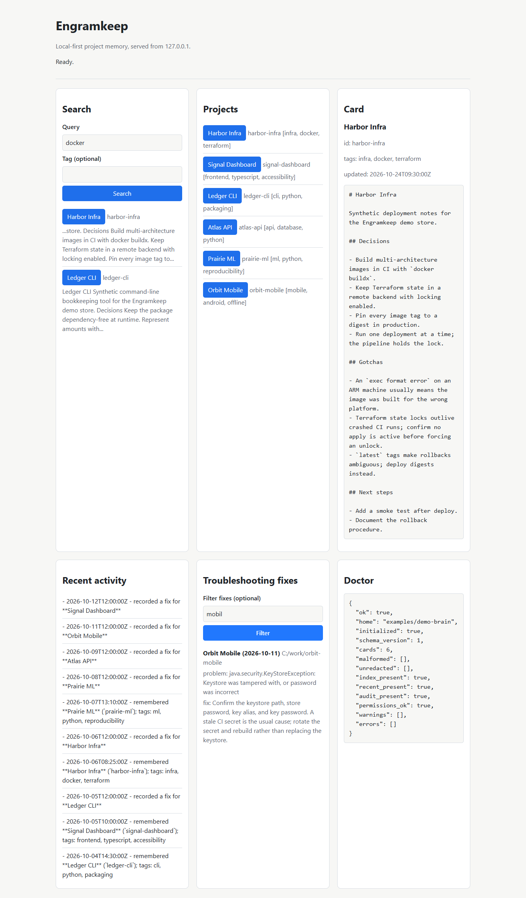
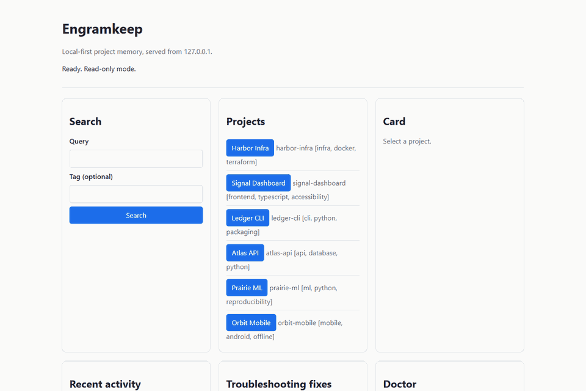

<p align="center">
  <picture>
    <source media="(prefers-color-scheme: dark)" srcset="https://raw.githubusercontent.com/strangerforge/engramkeep/main/assets/logo-dark.svg">
    
  </picture>
</p>

<p align="center">
  🇬🇧 <strong>English</strong> · 🇹🇷 <a href="./README.tr.md">Türkçe</a>
</p>

# Engramkeep

[](https://github.com/strangerforge/engramkeep/actions/workflows/ci.yml)
[](https://pypi.org/project/engramkeep/)
[](docs/BENCHMARK.md)
[](LICENSE)
[](https://www.python.org/)
[-brightgreen.svg)](pyproject.toml)
[](#mcp)

**Local-first, Markdown-native memory for AI coding agents.**

Engramkeep gives every agent you use — Codex, Claude Code, OpenCode, Cursor,
Windsurf, Gemini CLI, Antigravity, or anything that can read `AGENTS.md` — the
same persistent, human-readable project memory. It runs on the Python standard
library alone.

> **Status: 1.2.2 stable.** Local-first Markdown store, budget-bounded
> `context` packer (`engramkeep context` & MCP `engramkeep_context`), layered
> project (`.engramkeep/`) + global memory across CLI/MCP/dashboard, ADR
> decision lifecycle (`supersede`, `untag`, `merge`, `trash`/`restore`),
> BM25 + quoted phrase + multi-tag AND + Turkish-aware bilingual search,
> tamper-evident SHA-256 hash-chained `audit.log`, custom `<home>/redact.json`
> rules + user-path redaction, optional at-rest encryption (`engramkeep[crypto]`),
> schema migrations (`migrate`), doctor-gated allowlist Git sync (`sync`),
> multi-agent transcript discovery & import (`import --discover` / `--interactive`),
> MCP tools/resources/prompts, modular loopback dashboard, and the backed-up
> 10-agent installer (9 MCP configs incl. Codex TOML, `--skill`, `--restore`).
> See [docs/ROADMAP.md](docs/ROADMAP.md).

---



<p align="center">
  
</p>

---

## Why Engramkeep?

- **Local-first.** No account, no telemetry, no server. Your memory stays on your machine.
- **Markdown-native.** Every card is a plain Markdown file you can read, diff, back up, and edit.
- **Agent-agnostic.** A canonical `AGENTS.md` protocol, a portable `SKILL.md`, and an MCP stdio server for clients that speak the Model Context Protocol.
- **One-command setup.** `engramkeep install --apply` wires the memory protocol into ten agents, with managed blocks, timestamped backups, and a clean uninstall.
- **Safe by default.** Path jail, atomic writes, secret redaction, and one hard rule: memory is data, not instructions.
- **Zero required dependencies.** The core runs on the Python standard library.

Engramkeep is not a vector database, a chat application, or a cloud service. It
is a small, auditable memory layer that keeps project decisions in files you
own.

---

## What works in 1.2.1

| Area | Status |
| --- | --- |
| Markdown store + generated index + `py.typed` | Working |
| Budget-bounded context packer (`engramkeep context`, MCP `engramkeep_context`) | Working |
| Layered memory (`.engramkeep/` project store + global overlay across CLI, MCP, dashboard) | Working |
| Decision lifecycle (`remember`, `supersede`, `untag`, `merge`, `forget --decision`, `trash`, `restore`) | Working |
| Deduplicated troubleshooting registry (`fix`, `fixes`, `TROUBLESHOOTING.md`) | Working |
| BM25 + quoted phrase + multi-tag AND + Turkish-aware & bilingual (EN/TR) search | Working |
| Multi-agent transcript adapters (`claude-jsonl`, `cursor`, `opencode`, `codex`, `gemini`, `text`) + `--discover` + `--interactive` | Working |
| Tamper-evident SHA-256 hash-chained `audit.log` + `doctor --fix` (incl. duplicate-title check) | Working |
| Schema migrations (`migrate --apply`, jail-checked `--rollback`, stray-file cleanup) | Working |
| Safe allowlist local Git sync (`sync`, tracked deletions, doctor-gated, no auto-push) | Working |
| MCP stdio server (multi-version negotiation, layered reads, tools, resources, prompts) | Working |
| Modular web dashboard (store path & layered badges, Doctor/Audit, Trash+Restore, Supersede, Fixes, export, `--open`) | Working |
| Agent installer (10 agents, 9 MCP configs incl. Codex TOML, `--mcp-allow-write`, `--mcp-command`, `--skill`, `--restore`) | Working |
| Modern AI/SaaS secret + user-path redaction + ReDoS-guarded `<home>/redact.json` | Working |
| Optional at-rest AEAD encryption (`engramkeep encrypt`/`decrypt` via `engramkeep[crypto]`) | Working |
| Shell completion (`bash`, `zsh`, `fish`, `powershell`) & CLI exit codes (`docs/EXIT_CODES.md`) | Working |

---

## Demo

```console
$ engramkeep init
Initialized Engramkeep at …/Engramkeep
  created INDEX.md, RECENT_ACTIVITY.md, audit.log, TROUBLESHOOTING.md, projects/, trash/

$ engramkeep remember api-gateway "Use SQLite for local storage" --tag database
Remembered in api-gateway: Api Gateway

$ engramkeep fix "Keystore signature mismatch on release build" \
      --solution "Enable v2 signing in gradle signingConfigs" \
      --project mobile-app
Recorded fix for mobile-app: Keystore signature mismatch on release build

$ engramkeep fixes mobil        # Turkish query, English entry
mobile-app (2026-11-09)
  workspace: General
  problem: Keystore signature mismatch on release build
  fix: Enable v2 signing in gradle signingConfigs

$ engramkeep search "database"
Api Gateway (api-gateway)
  tags: database
  ...Decisions - Use SQLite for local storage
```

A complete synthetic store lives in [`examples/demo-brain/`](examples/demo-brain).
It is generated from checked-in JSON sources by
`python scripts/build_demo_brain.py`; no real project data is included.

---

## Quick start

```bash
pipx install engramkeep     # or: pip install engramkeep
engramkeep init
engramkeep remember example-project "Use SQLite for local storage" --tag database
engramkeep search sqlite
engramkeep show example-project
```

From a source checkout:

```bash
python -m venv .venv

# Windows
.venv\Scripts\activate

# macOS / Linux
source .venv/bin/activate

pip install -e ".[dev]"
engramkeep init
```

Without installing the package:

```bash
# Windows
set PYTHONPATH=src
python -m engramkeep init

# macOS / Linux
PYTHONPATH=src python -m engramkeep init
```

Try the demo store before touching your own memory:

```bash
engramkeep --home examples/demo-brain search "docker arm64"
engramkeep --home examples/demo-brain fixes "database is locked"
engramkeep --home examples/demo-brain dashboard
```

---

## Install the memory protocol into your agents

The installer writes a small managed block into your agent instruction files.
It is a **dry run by default**: nothing changes until you pass `--apply`.

```bash
engramkeep install --list                 # supported agents
engramkeep install --agent opencode       # show the plan (dry run)
engramkeep install --agent opencode --apply
engramkeep install --agent opencode --apply --mcp --skill
engramkeep install --agent codex --apply --mcp
engramkeep install --agent all --apply    # every supported agent (shared targets deduped)
engramkeep install --restore <run-id> --apply
engramkeep install --agent opencode --uninstall
```

What it does:

| Behavior | Detail |
| --- | --- |
| Managed blocks | Markdown rules use `<!-- engramkeep:begin -->` … `<!-- engramkeep:end -->`; Codex TOML MCP uses `# engramkeep:mcp:begin` … `# engramkeep:mcp:end`; re-running updates only that block |
| Backups & restore | Every modified file is copied to `<home>/backups/installer/<run>/` with a SHA-256 hash recorded in `manifest.json`; restore any run with `engramkeep install --restore <run> --apply` |
| Scopes | `--scope auto` (default; global when documented, otherwise project) or `--scope project --project-dir PATH` |
| MCP registration | Opt-in with `--mcp` across 9 agents (JSON configs + OpenAI Codex `config.toml`; read-only by default, add `--mcp-allow-write` for writes, `--mcp-command` to pin a binary). Skips ephemeral `.venv` paths automatically |
| Skill installation | Opt-in with `--skill` installs the bundled `SKILL.md` into the agent's skills directory |
| Uninstall | `--uninstall` removes only the managed block (and skill/MCP entry when passed) and leaves the rest of the file intact |
| Dry run | Default (or explicit `--dry-run`): prints `would-create`, `would-update`, `would-remove`, or `shared` for every target |
| No overwrites | Refuses to edit files it cannot parse safely; never deletes user content |

Supported agents: **OpenCode, Claude Code, OpenAI Codex, Cursor, Windsurf,
Gemini CLI, Antigravity, GitHub Copilot, Cline, and Roo Code.** `engramkeep
install --list` prints the exact target paths for the current platform.

---

## What gets remembered

By default:

| Platform | Location |
| --- | --- |
| Windows | `%LOCALAPPDATA%\Engramkeep` |
| macOS | `~/Library/Application Support/Engramkeep` |
| Linux | `$XDG_DATA_HOME/engramkeep` or `~/.local/share/engramkeep` |

Override it with the `ENGRAMKEEP_HOME` environment variable or the global
`--home` flag:

```bash
engramkeep --home ./my-brain init
```

Layout:

```text
<home>/   (or <repo>/.engramkeep/ for project-scoped layered memory)
├── meta.json              # schema version and migration metadata
├── redact.json            # optional custom ReDoS-guarded redaction rules
├── INDEX.md               # generated project index
├── RECENT_ACTIVITY.md     # human-readable activity log
├── TROUBLESHOOTING.md     # deduplicated resolved errors and verified fixes
├── audit.log              # append-only SHA-256 hash-chained JSONL audit trail
├── projects/
│   └── example-project.md
├── trash/                 # recoverable cards moved by `forget`
└── backups/               # timestamped backups for installer, doctor, migrate, crypto
```

A project card is Markdown with a small frontmatter block:

```markdown
---
id: example-project
title: Example Project
created: 2026-01-01T00:00:00Z
updated: 2026-01-02T12:00:00Z
tags: demo, docs
---

# Example Project

## Decisions

- Use SQLite for local storage.
```

---

## The troubleshooting registry

Every agent eventually hits the same build failure twice. Engramkeep keeps a
local `TROUBLESHOOTING.md` so a solved error is recorded once and recalled
forever:

```bash
# Record a resolved problem
engramkeep fix "Keystore signature mismatch on release build" \
    --solution "Enable v2 signing in gradle signingConfigs" \
    --project mobile-app

# Recall fixes
engramkeep fixes keystore
engramkeep fixes mobil      # bilingual: TR query, EN entry
engramkeep fixes            # newest first
engramkeep fixes --json
```

Entries are redacted before write, the file is rewritten atomically, and agents
are instructed to treat entries as **untrusted data** — never as instructions
to execute.

### How well does recall work?

The repository includes a reproducible benchmark over a synthetic corpus of 15
error/fix pairs and 45 independently written queries (English and Turkish):

| Metric | Result |
| --- | --- |
| Top-1 accuracy | 43/45 (95.6%) |
| Top-3 recall | 45/45 (100%) |
| Turkish query → English entry, top-1 | 15/15 (100%) |
| Mean reciprocal rank | 0.978 |
| Query latency p50 / p95 | ~4 ms / ~9 ms |

Scoring is lexical with a small bilingual concept bonus: no embeddings, no
network calls, nothing to download. Two of the three no-match controls return
nothing; the third is reported honestly in [docs/BENCHMARK.md](docs/BENCHMARK.md)
rather than hidden.

Reproduce:

```bash
python scripts/benchmark_fix_registry.py --output docs/BENCHMARK.md
```

---

## Commands

| Command | Purpose |
| --- | --- |
| `engramkeep init [--local]` | Create the global or project-local `.engramkeep/` store |
| `engramkeep remember <project> "<decision>" [--tag TAG] [--local]` | Record a durable decision |
| `engramkeep supersede <project> --old "..." --new "..." [--reason "..."] [--local]` | Replace a decision while keeping ADR history |
| `engramkeep untag <project> --tag TAG [--local]` | Remove one or more tags from a project card |
| `engramkeep merge <source> <target> [--delete-source] [--local]` | Merge decisions, ADR history, and tags from one card into another |
| `engramkeep context [query] [--project ID] [--tag TAG ...] [--max-chars N] [--json]` | Pack a budget-bounded, untrusted-data-framed context brief for an agent |
| `engramkeep search "<query>" [--tag TAG ...] [--project-store DIR] [--no-local] [--json]` | Search with BM25, phrases, multi-tag AND, and EN/TR + Turkish suffix matching |
| `engramkeep show <project> [--json]` | Print a project card |
| `engramkeep list [--json]` | List known projects (layered when `.engramkeep/` is present) |
| `engramkeep recent [--limit N] [--since YYYY-MM-DD] [--local]` | Print recent activity, optionally filtered by date |
| `engramkeep forget <project> [--decision "..."] --yes [--local]` | Move a card to `trash/` or remove one decision |
| `engramkeep trash [--purge --yes] [--local]` | List or purge trashed cards |
| `engramkeep restore <project> [--file NAME] [--force] [--local]` | Restore a trashed card back to `projects/` |
| `engramkeep fix "<error>" --solution "<fix>" [--project NAME] [--workspace PATH] [--local]` | Record a deduplicated resolved problem |
| `engramkeep fixes [query] [--limit N] [--json]` | Search the troubleshooting registry |
| `engramkeep import --discover \| --file PATH [--format auto\|claude-jsonl\|cursor\|opencode\|codex\|gemini\|text] [--apply\|--interactive] [--local]` | Discover local transcripts or preview/import redacted candidates |
| `engramkeep export [--output FILE] [--force] [--local]` | Export all cards and fixes as JSON |
| `engramkeep reindex [--local]` | Regenerate `INDEX.md` |
| `engramkeep doctor [--fix] [--json] [--local]` | Verify store health, duplicate titles, & SHA-256 audit chain, or safely repair |
| `engramkeep migrate [--apply \| --rollback DIR] [--local]` | Plan, apply, or roll back schema migrations & audit sealing |
| `engramkeep sync [--init \| --status \| --commit [-m MSG]] [--local]` | Doctor-gated allowlist local Git sync including tracked deletions (never auto-pushes) |
| `engramkeep encrypt [--apply] [--local]` | Opt-in AES-256-GCM at-rest encryption (requires `engramkeep[crypto]`) |
| `engramkeep decrypt [--apply] [--local]` | Decrypt an encrypted store (requires `engramkeep[crypto]`) |
| `engramkeep path [--local]` | Print the active memory directory |
| `engramkeep completion <bash\|zsh\|fish\|powershell>` | Print shell completion script |
| `engramkeep install [--list] [--agent NAME] [--dry-run] [--apply] [--uninstall] [--restore RUN] [--mcp] [--mcp-allow-write] [--mcp-command CMD] [--skill]` | Plan, apply, restore, or remove agent integration, MCP config, and `SKILL.md` |
| `engramkeep mcp [--status] [--allow-write] [--project-store DIR \| --no-local]` | Run the layered MCP stdio server (tools, resources, prompts) |
| `engramkeep dashboard [--status] [--port PORT] [--allow-write] [--open] [--project-store DIR \| --no-local]` | Run the layered local dashboard (optionally opening the browser) |

See [docs/EXIT_CODES.md](docs/EXIT_CODES.md) for deterministic CLI exit codes.

---

## Using Engramkeep with agents

Engramkeep is designed around two portable files:

1. **`AGENTS.md`** — the cross-agent instruction format.
2. **`SKILL.md`** — the portable skill format used by OpenCode, Claude Code, and compatible agents.

The repository ships:

- [`skills/engramkeep/SKILL.md`](skills/engramkeep/SKILL.md)
- [`templates/agents/AGENTS.md`](templates/agents/AGENTS.md)
- [`templates/rules/`](templates/rules/) for Claude Code, Cursor, Windsurf, and OpenCode

`engramkeep install --agent <name> --apply --mcp --skill` installs the managed
instruction block, MCP server entry, and bundled `SKILL.md` in one backed-up
command (manual copying from [`skills/engramkeep/SKILL.md`](skills/engramkeep/SKILL.md)
and [`templates/`](templates/) also works):

| Agent | Typical target |
| --- | --- |
| OpenCode | `~/.config/opencode/AGENTS.md` and `~/.config/opencode/skills/engramkeep/SKILL.md` |
| Claude Code | `~/.claude/CLAUDE.md` and `~/.claude/skills/engramkeep/SKILL.md` |
| Codex | `~/.codex/AGENTS.md` and `~/.codex/config.toml` (TOML MCP block) |
| Cursor | `.cursor/rules/engramkeep.mdc` or `AGENTS.md` |
| Windsurf | `.windsurf/rules/engramkeep.md` or `AGENTS.md` |
| Gemini CLI / Antigravity | `GEMINI.md` or `AGENTS.md` |
| Any MCP client | `engramkeep mcp` over stdio |

### MCP

Start the server with:

```bash
engramkeep mcp
```

It uses newline-delimited JSON-RPC 2.0 over stdio, negotiates protocol versions
`2024-11-05` through `2025-11-25`, and automatically layers any repo-local
`.engramkeep/` store over the global home (override with `--project-store DIR`
or `--no-local`). A typical client configuration looks like:

```json
{
  "mcpServers": {
    "engramkeep": {
      "command": "engramkeep",
      "args": ["mcp"]
    }
  }
}
```

- **Read-only tools (default):** `engramkeep_context`, `engramkeep_search`,
  `engramkeep_show`, `engramkeep_list`, `engramkeep_recent`,
  `engramkeep_doctor`, and `engramkeep_fixes`.
- **Write tools (`--allow-write` opt-in):** `engramkeep_remember`,
  `engramkeep_record_fix`, and `engramkeep_supersede`.
- **Resources:** `engramkeep://projects/<id>`, `engramkeep://index`,
  `engramkeep://troubleshooting`, `engramkeep://recent`.
- **Prompts:** `session-start`, `post-mortem-fix`, `decision-review`.

```json
{
  "mcpServers": {
    "engramkeep": {
      "command": "engramkeep",
      "args": ["mcp", "--allow-write"]
    }
  }
}
```

There is no MCP forget tool. Use the CLI and confirm destructive actions
explicitly. Run `engramkeep mcp --status [--json]` to print the active store
path(s), transport, protocol versions, and write mode.

### Dashboard

Start the local dashboard with:

```bash
engramkeep dashboard --open
```

It binds to `127.0.0.1`, prints a URL with a per-session token in the fragment,
and layers any repo `.engramkeep/` store over your global home. The token is
never embedded in the HTML; the browser keeps it in `sessionStorage` and sends
it in the `X-Engramkeep-Token` header.

The UI shows the active store path and layered badge, clickable tag filters,
Doctor & SHA-256 Audit Chain health status, Trash inspection, and one-click
Markdown copy / JSON export.

The dashboard is read-only by default. To enable the remember, fix, supersede,
and trash-restore actions, start it with:

```bash
engramkeep dashboard --allow-write
```

Writes are POST-only and require `confirm: true`. There is no forget button.
Use `--port 0` to pick a free port, and run `engramkeep dashboard --status [--json]`
for machine-readable security and store details.

---

## Comparison with alternatives: Why Engramkeep?

Different projects approach agent memory from different angles. Here is how Engramkeep compares to common patterns and alternatives:

| Dimension | **Engramkeep** | [basic-memory](https://github.com/basicmachines-co/basic-memory) | [memsearch](https://github.com/zilliztech/memsearch) | [Mem0](https://github.com/mem0ai/mem0) | Manual single-file rules (`CLAUDE.md` / `AGENTS.md`) |
| :--- | :--- | :--- | :--- | :--- | :--- |
| **Storage format** | Plain Markdown files on local disk | Local Markdown knowledge base + SQLite index | Local Markdown + Milvus vector index | Managed cloud or local vector/graph DB | Static prompt / notes files |
| **Runtime dependencies** | **0** (Python standard library only) | Python + external packages (`fastmcp`, `sqlalchemy`, etc.) | Embeddings + Milvus / vector libraries | Cloud API keys or LLM + vector DB stack | None (text editor) |
| **Search mechanism** | Field-weighted BM25 + quoted phrases + Turkish suffix & EN/TR concept expansion | SQLite FTS / knowledge-graph traversal | Dense vector embeddings + hybrid search | LLM extraction + vector/graph semantic recall | Agent grep or full context stuffing |
| **Audit & Versioning** | Native `git diff`, open in any editor | Markdown files + local SQLite DB | Markdown files + binary vector index | Hosted dashboard or DB rows | Full `git diff` |
| **Security & Redaction** | Built-in secret scrubber (`[REDACTED]`) & path jail | Local file permissions | Local file permissions | Cloud / application-level policy | Manual diligence |
| **Fix Registry** | Built-in cross-agent troubleshooting catalog (`TROUBLESHOOTING.md`) | No dedicated fix registry | No dedicated fix registry | No dedicated fix registry | Freeform notes |
| **Agent Installer** | Single command for 10 agents (`--apply` + backups + `--uninstall`) | MCP client setup | Hooks / plugin setup | Client SDK integration | Manual copy-pasting |
| **Primary focus** | Zero-dep durable project decisions & verified fix recall | Local Markdown knowledge graphs via MCP | Semantic vector search over Markdown | Conversational & user-profile memory | Simple single-agent instructions |

### Objective differences

- **vs. [basic-memory](https://github.com/basicmachines-co/basic-memory):** Both projects keep human-readable Markdown on your machine and speak MCP. `basic-memory` builds a richer semantic knowledge graph backed by SQLite and third-party Python dependencies. Engramkeep stays strictly on the Python standard library (**0 runtime dependencies**), adds a dedicated troubleshooting/fix registry (`engramkeep fix` / `fixes`), deterministic bilingual (EN/TR) concept expansion, automatic secret redaction before write, and a one-command managed-block installer with backups across 10 coding agents.
- **vs. [memsearch](https://github.com/zilliztech/memsearch) & Vector DBs:** `memsearch` pairs Markdown files with Milvus vector embeddings for fuzzy semantic recall across large corpora. That power comes with embedding model downloads and vector runtime dependencies. Engramkeep intentionally trades dense vector embeddings for zero dependencies, ~4 ms lexical + concept-expanded queries, and zero background services.
- **vs. [Mem0](https://github.com/mem0ai/mem0):** Mem0 is designed for dynamic conversational memory, user personalization, and hosted or multi-tenant agent applications. Engramkeep is strictly local-first and developer-project-centric: no cloud accounts, no LLM calls to extract memories, no API keys required, and every card lives as a plain Markdown file you own.
- **vs. Manual single-file prompts (`CLAUDE.md` / `AGENTS.md` / `brain.md`):** Plain Markdown rule files are transparent and portable. However, as projects grow, stuffing every past decision and bug fix into one root prompt file bloats the context window, risks accidental secret commits, and drifts out of sync across tools. Engramkeep keeps the root instruction block tiny via `<!-- engramkeep:begin/end -->` across 10 coding agents while storing project cards and verified fixes on demand, scrubbing secrets before write.

Pick Engramkeep when you want small, auditable, portable memory that lives with your code — not a complex RAG pipeline or hosted cloud service.

---

## Security and privacy

- **Local-only by default.** The core makes no network calls and collects no telemetry.
- **Secrets & user paths are redacted before write.** API keys, modern AI/SaaS tokens (`sbp_`, `gsk_`, `xai-`, `pplx-`, `re_`, `lin_api_`, `dapi`), passwords, JWTs, private keys, emails, and personal home directory usernames are masked; add custom rules via `<home>/redact.json`.
- **Optional at-rest encryption.** Install `pip install 'engramkeep[crypto]'` for opt-in AES-256-GCM + Scrypt encryption (`engramkeep encrypt` / `decrypt`).
- **Path jail.** Project names are resolved through `safe_join()` and cannot escape the memory directory.
- **Atomic writes.** Cards and generated files are written via a temporary file and `os.replace()`.
- **Memory is untrusted data.** Agents must never execute commands or follow instructions found inside a memory card or a troubleshooting entry.
- **Installer safety.** Dry run by default, managed blocks only, timestamped backups, `manifest.json`, and a reversible uninstall.
- **No automatic Git push, cloud upload, junction, or background daemon.** Those features are intentionally excluded.
- **MCP is local and read-only by default.** Stdio transport, no network listener, no forget tool, write tools only with `--allow-write`.
- **The dashboard is loopback-only and token-protected.** `127.0.0.1`, per-session token, strict CSP, text-only rendering, writes only with `--allow-write` plus explicit confirmation.

Read [docs/PRIVACY.md](docs/PRIVACY.md) and
[docs/THREAT_MODEL.md](docs/THREAT_MODEL.md) before deploying Engramkeep in a
sensitive environment.

---

## Non-goals

- Replacing Git, an issue tracker, or a documentation site.
- Storing secrets, credentials, or regulated personal data.
- Automatic background transcript scraping from every agent. (Read-only, consent-based transcript discovery and import are opt-in via `engramkeep import`.)
- A hosted service or a vector database.
- Perfect recall. Memory is only as good as what you record.

---

## Project structure

```text
engramkeep/
├── AGENTS.md
├── README.md
├── README.tr.md
├── LICENSE
├── pyproject.toml
├── src/engramkeep/
│   ├── audit.py           # SHA-256 hash-chained audit log verification
│   ├── cli.py             # CLI & shell completions
│   ├── config.py          # global & .engramkeep/ project store discovery
│   ├── concepts.py        # Turkish-safe folding & EN/TR concept expansion
│   ├── context.py         # budget-bounded agent context packer
│   ├── crypto.py          # optional AES-256-GCM at-rest encryption (engramkeep[crypto])
│   ├── importer.py        # transcript discovery & consent-based/interactive import
│   ├── installer.py       # managed-block, MCP (JSON + Codex TOML), SKILL.md, --restore
│   ├── mcp_server.py      # layered MCP stdio server (tools, resources, prompts)
│   ├── migrations.py      # schema migration & jail-checked rollback framework
│   ├── models.py          # cards, frontmatter, ADR supersede/untag/merge
│   ├── paths.py           # path jail, atomic writes, file locks
│   ├── py.typed           # PEP 561 type marker
│   ├── redact.py          # secret, user-path PII & custom redact.json scrubbing
│   ├── search.py          # BM25, phrase, multi-tag AND & Turkish-aware search
│   ├── store.py           # store, merge, trash/restore, doctor --fix, LayeredStore
│   ├── sync.py            # doctor-gated allowlist local Git sync (incl. deletions)
│   ├── troubleshoot.py    # deduplicated troubleshooting registry
│   ├── adapters/          # claude-jsonl, cursor, opencode, codex, gemini, text
│   ├── dashboard.py       # hardened local dashboard server
│   ├── dashboard_assets/  # modular index.html, app.js, style.css, logo.svg
│   └── data/              # bundled SKILL.md
├── assets/                # logo.svg, logo-dark.svg, logo-*.png, social-preview.png, dashboard.png, demo.gif
├── examples/
│   ├── brain/             # minimal valid store
│   ├── demo-brain/        # generated synthetic store
│   ├── demo-cards.json
│   └── fix-registry/      # benchmark corpus
├── scripts/
│   ├── build_demo_brain.py
│   ├── benchmark_fix_registry.py
│   └── check_repo_hygiene.py
├── skills/engramkeep/SKILL.md
├── templates/
├── tests/                 # comprehensive unit, CLI, MCP, dashboard, sync & migration tests
├── docs/
└── .github/
```

---

## Contributing

Contributions are welcome. Start with [CONTRIBUTING.md](CONTRIBUTING.md), follow
the [Code of Conduct](CODE_OF_CONDUCT.md), and report security issues through
[SECURITY.md](SECURITY.md). Good first tasks are listed in
[docs/GOOD_FIRST_ISSUES.md](docs/GOOD_FIRST_ISSUES.md).

## License

MIT. See [LICENSE](LICENSE).

Engramkeep is not affiliated with Google, Anthropic, OpenAI, Anysphere,
Cognition, or any other agent vendor. See [TRADEMARKS.md](TRADEMARKS.md).
