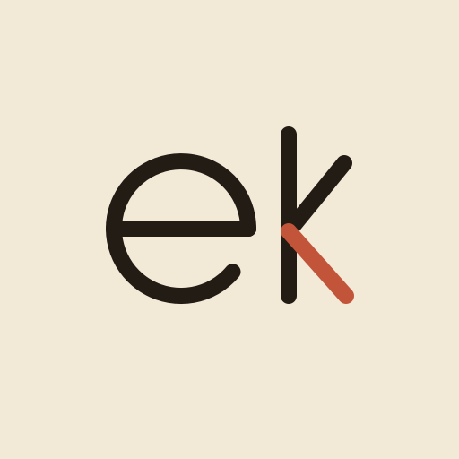
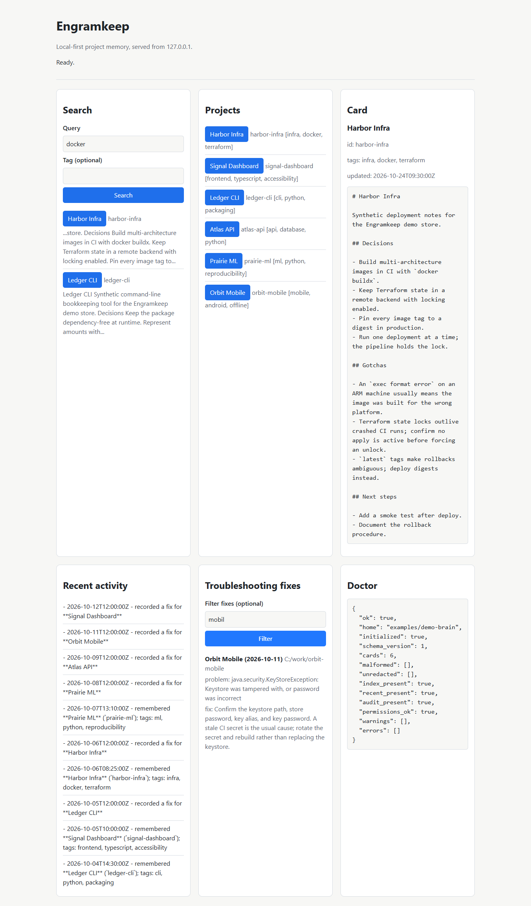
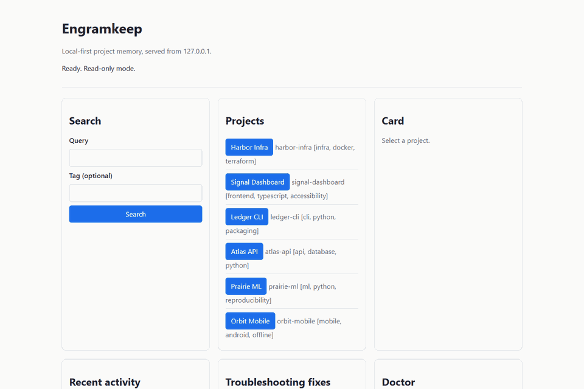

<p align="center">
  <picture>
    <source media="(prefers-color-scheme: dark)" srcset="https://raw.githubusercontent.com/strangerforge/engramkeep/main/assets/logo-dark.svg">
    
  </picture>
</p>

<p align="center">
  🇬🇧 <a href="./README.md">English</a> · 🇹🇷 <strong>Türkçe</strong>
</p>

# Engramkeep

[](https://github.com/strangerforge/engramkeep/actions/workflows/ci.yml)
[](https://pypi.org/project/engramkeep/)
[](docs/BENCHMARK.md)
[](LICENSE)
[](https://www.python.org/)
[-brightgreen.svg)](pyproject.toml)
[](#mcp)

**Yapay zeka kod ajanları için yerel-öncelikli, Markdown tabanlı kalıcı hafıza.**

Engramkeep; Codex, Claude Code, OpenCode, Cursor, Windsurf, Gemini CLI,
Antigravity veya `AGENTS.md` okuyabilen her ajanın aynı proje hafızasını
kullanmasını sağlar. Yalnızca Python standart kütüphanesiyle çalışır.

> **Durum: 1.2.1 kararlı.** Yerel-öncelikli Markdown deposu, bütçe sınırlı
> `context` paketleyici (`engramkeep context` ve MCP `engramkeep_context`),
> CLI/MCP/panel genelinde katmanlı proje (`.engramkeep/`) + global hafıza,
> ADR karar yaşam döngüsü (`supersede`, `untag`, `merge`, `trash`/`restore`),
> BM25 + tam ifade + çoklu etiket VE + Türkçe uyumlu çift dilli arama,
> SHA-256 hash zincirli `audit.log`, özel `<home>/redact.json` kuralları +
> kullanıcı yolu maskeleme, isteğe bağlı disk şifreleme (`engramkeep[crypto]`),
> şema göçü (`migrate`), doctor kontrollü allowlist Git senkronizasyonu (`sync`),
> çoklu ajan transkript keşfi ve içe aktarımı (`import --discover` / `--interactive`),
> MCP tools/resources/prompts, modüler yerel panel ve 10 ajan için yedekli
> kurulum (Codex TOML dahil 9 MCP yapılandırması, `--skill`, `--restore`).
> Bkz. [docs/ROADMAP.md](docs/ROADMAP.md).

---



<p align="center">
  
</p>

---

## Neden Engramkeep?

- **Yerel-öncelikli.** Hesap yok, telemetri yok, sunucu yok. Hafıza makinenin dışına çıkmaz.
- **Markdown-native.** Her kart düz Markdown; okuyabilir, diff'leyebilir, yedekleyebilir ve düzenleyebilirsin.
- **Ajandan bağımsız.** Ortak `AGENTS.md` protokolü, taşınabilir `SKILL.md` ve Model Context Protocol konuşan istemciler için MCP stdio sunucusu.
- **Tek komutla kurulum.** `engramkeep install --apply` hafıza protokolünü on ajana bağlar; managed block, zaman damgalı yedek ve temiz kaldırma ile.
- **Varsayılan olarak güvenli.** Yol hapsi, atomik yazma, sır temizleme ve tek kural: hafıza veridir, talimat değildir.
- **Zorunlu bağımlılık yok.** Çekirdek yalnızca Python standart kütüphanesiyle çalışır.

Engramkeep bir vektör veritabanı, sohbet uygulaması veya bulut servisi
değildir. Sahip olduğun dosyalarda proje kararlarını tutan küçük ve
denetlenebilir bir hafıza katmanıdır.

---

## 1.2.1'da ne çalışıyor?

| Alan | Durum |
| --- | --- |
| Markdown deposu + üretilen indeks + `py.typed` | Çalışıyor |
| Bütçe sınırlı bağlam paketleyici (`engramkeep context`, MCP `engramkeep_context`) | Çalışıyor |
| Katmanlı hafıza (CLI, MCP ve panelde `.engramkeep/` proje deposu + global katman) | Çalışıyor |
| Karar yaşam döngüsü (`remember`, `supersede`, `untag`, `merge`, `forget --decision`, `trash`, `restore`) | Çalışıyor |
| Mükerrer korumalı arıza giderme kayıt defteri (`fix`, `fixes`, `TROUBLESHOOTING.md`) | Çalışıyor |
| BM25 + tam ifade + çoklu etiket VE + Türkçe ek/yumuşama ve çift dilli (EN/TR) arama | Çalışıyor |
| Çoklu ajan transkript adaptörleri (`claude-jsonl`, `cursor`, `opencode`, `codex`, `gemini`, `text`) + `--discover` + `--interactive` | Çalışıyor |
| SHA-256 hash zincirli `audit.log` + `doctor --fix` (mükerrer başlık uyarısı dahil) | Çalışıyor |
| Şema göçü (`migrate --apply`, yol hapsi kontrollü `--rollback`, artık dosya temizliği) | Çalışıyor |
| Güvenli allowlist yerel Git senkronizasyonu (`sync`, silinen kart takibi, doctor kapılı, otomatik push yok) | Çalışıyor |
| MCP stdio sunucusu (çoklu sürüm müzakeresi, katmanlı okuma, tools, resources, prompts) | Çalışıyor |
| Modüler web paneli (depo yolu & katman rozetleri, Doctor/Audit, Çöp+Geri Yükle, Supersede, Fixes, export, `--open`) | Çalışıyor |
| Ajan kurulumu (10 ajan, Codex TOML dahil 9 MCP, `--mcp-allow-write`, `--mcp-command`, `--skill`, `--restore`) | Çalışıyor |
| Modern AI/SaaS sır + kullanıcı yolu maskeleme + ReDoS korumalı `<home>/redact.json` | Çalışıyor |
| İsteğe bağlı AES-256-GCM disk şifreleme (`engramkeep encrypt`/`decrypt`, `engramkeep[crypto]`) | Çalışıyor |
| Kabuk otomatik tamamlama (`bash`, `zsh`, `fish`, `powershell`) ve çıkış kodları (`docs/EXIT_CODES.md`) | Çalışıyor |

---

## Demo

```console
$ engramkeep init
Initialized Engramkeep at …/Engramkeep
  created INDEX.md, RECENT_ACTIVITY.md, audit.log, TROUBLESHOOTING.md, projects/, trash/

$ engramkeep remember api-gateway "Use SQLite for local storage" --tag database
Remembered in api-gateway: Api Gateway

$ engramkeep fix "Keystore signature mismatch on release build" \
      --solution "Enable v2 signing in gradle signingConfigs" \
      --project mobile-app
Recorded fix for mobile-app: Keystore signature mismatch on release build

$ engramkeep fixes mobil        # Türkçe sorgu, İngilizce kayıt
mobile-app (2026-11-09)
  workspace: General
  problem: Keystore signature mismatch on release build
  fix: Enable v2 signing in gradle signingConfigs

$ engramkeep search "veritabanı"
Api Gateway (api-gateway)
  tags: database
  ...Decisions - Use SQLite for local storage
```

Tamamen sentetik bir depo [`examples/demo-brain/`](examples/demo-brain)
dizininde duruyor. Depodaki JSON kaynaklarından
`python scripts/build_demo_brain.py` ile üretilir; gerçek proje verisi içermez.

---

## Hızlı başlangıç

```bash
pipx install engramkeep     # veya: pip install engramkeep
engramkeep init
engramkeep remember example-project "Yerel depolama için SQLite kullan" --tag database
engramkeep search sqlite
engramkeep show example-project
```

Kaynak koddan:

```bash
python -m venv .venv

# Windows
.venv\Scripts\activate

# macOS / Linux
source .venv/bin/activate

pip install -e ".[dev]"
engramkeep init
```

Paketi kurmadan:

```bash
# Windows
set PYTHONPATH=src
python -m engramkeep init

# macOS / Linux
PYTHONPATH=src python -m engramkeep init
```

Kendi hafızana dokunmadan demo deposunu dene:

```bash
engramkeep --home examples/demo-brain search "docker arm64"
engramkeep --home examples/demo-brain fixes "database is locked"
engramkeep --home examples/demo-brain dashboard
```

---

## Hafıza protokolünü ajanlarına kur

Kurulum, ajan talimat dosyalarına küçük bir managed block yazar. Varsayılan
olarak **dry run**'dır: `--apply` vermeden hiçbir şey değişmez.

```bash
engramkeep install --list                 # desteklenen ajanlar
engramkeep install --agent opencode       # planı göster (dry run)
engramkeep install --agent opencode --apply
engramkeep install --agent opencode --apply --mcp --skill
engramkeep install --agent codex --apply --mcp
engramkeep install --agent all --apply    # desteklenen tüm ajanlar (ortak hedefler tekilleştirilir)
engramkeep install --restore <çalıştırma> --apply
engramkeep install --agent opencode --uninstall
```

Ne yapar:

| Davranış | Ayrıntı |
| --- | --- |
| Managed block | Markdown kuralları `<!-- engramkeep:begin -->` … `<!-- engramkeep:end -->`, Codex TOML MCP bloğu `# engramkeep:mcp:begin` … `# engramkeep:mcp:end` kullanır |
| Yedekler ve geri alma | Değişen her dosya SHA-256 özetiyle `<home>/backups/installer/<çalıştırma>/` altına kopyalanır ve `manifest.json`'a yazılır; `engramkeep install --restore <çalıştırma> --apply` ile geri yüklenebilir |
| Kapsam | `--scope auto` (varsayılan; belgelenmişse global, değilse proje) veya `--scope project --project-dir YOL` |
| MCP kaydı | `--mcp` ile 9 ajanda opt-in (JSON dosyaları + OpenAI Codex `config.toml`; varsayılan salt-okunur, `--mcp-allow-write` ile yazma, `--mcp-command` ile sabit komut). Geçici `.venv` yollarını otomatik atlar |
| Skill kurulumu | `--skill` ile paket içindeki `SKILL.md` ilgili ajanın skills dizinine kurulur |
| Kaldırma | `--uninstall` yalnızca managed bloğu (ve seçildiyse skill/MCP kaydını) siler, dosyanın kalanına dokunmaz |
| Dry run | Varsayılan (veya açık `--dry-run`): her hedef için `would-create`, `would-update`, `would-remove` veya `shared` yazar |
| Üzerine yazmaz | Güvenle ayrıştıramadığı dosyaları düzenlemez; kullanıcı içeriğini silmez |

Desteklenen ajanlar: **OpenCode, Claude Code, OpenAI Codex, Cursor, Windsurf,
Gemini CLI, Antigravity, GitHub Copilot, Cline ve Roo Code.** `engramkeep
install --list` platforma göre tam hedef yollarını yazdırır.

---

## Hafıza nerede tutulur?

| Platform | Konum |
| --- | --- |
| Windows | `%LOCALAPPDATA%\Engramkeep` |
| macOS | `~/Library/Application Support/Engramkeep` |
| Linux | `$XDG_DATA_HOME/engramkeep` veya `~/.local/share/engramkeep` |

`ENGRAMKEEP_HOME` ortam değişkeni veya global `--home` bayrağı ile
değiştirilebilir:

```bash
engramkeep --home ./my-brain init
```

Dizin yapısı:

```text
<home>/   (veya proje bazlı katmanlı hafıza için <repo>/.engramkeep/)
├── meta.json              # şema sürümü ve göç üstverisi
├── redact.json            # isteğe bağlı ReDoS korumalı özel sır temizleme kuralları
├── INDEX.md               # üretilen proje indeksi
├── RECENT_ACTIVITY.md     # okunabilir aktivite günlüğü
├── TROUBLESHOOTING.md     # mükerrer korumalı çözülmüş hatalar ve çözümler
├── audit.log              # append-only SHA-256 hash zincirli denetim kaydı
├── projects/
│   └── example-project.md
├── trash/                 # `forget` ile taşınan kurtarılabilir kartlar
└── backups/               # installer, doctor, migrate ve crypto zaman damgalı yedekleri
```

Bir proje kartı, küçük bir frontmatter bloğu olan Markdown'dır:

```markdown
---
id: example-project
title: Example Project
created: 2026-01-01T00:00:00Z
updated: 2026-01-02T12:00:00Z
tags: demo, docs
---

# Example Project

## Decisions

- Use SQLite for local storage.
```

---

## Arıza giderme kayıt defteri

Her ajan eninde sonunda aynı build hatasıyla iki kez karşılaşır. Engramkeep,
çözülen hatayı bir kez kaydeder; sonsuza kadar hatırlar:

```bash
# Çözülmüş bir problemi kaydet
engramkeep fix "Keystore signature mismatch on release build" \
    --solution "Enable v2 signing in gradle signingConfigs" \
    --project mobile-app

# Çözümleri hatırla
engramkeep fixes keystore
engramkeep fixes mobil      # TR sorgu, EN kayıt
engramkeep fixes            # en yeniden eskiye
engramkeep fixes --json
```

Kayıtlar yazılmadan önce sır temizlemesinden geçer, dosya atomik olarak yeniden
yazılır ve ajanlara kayıtların **güvenilmeyen veri** olduğu — asla
çalıştırılacak talimat olmadığı — söylenir.

### Hatırlama ne kadar iyi?

Depo, 15 hata/çözüm çifti ve 45 bağımsız yazılmış sorgudan (İngilizce ve
Türkçe) oluşan sentetik bir korpus üzerinde tekrarlanabilir bir kıyaslama
içerir:

| Metrik | Sonuç |
| --- | --- |
| İlk sonuç doğruluğu | 43/45 (%95,6) |
| İlk üçte bulma | 45/45 (%100) |
| Türkçe sorgu → İngilizce kayıt, ilk sonuç | 15/15 (%100) |
| Ortalama karşılıklı sıra (MRR) | 0,978 |
| Sorgu gecikmesi p50 / p95 | ~4 ms / ~9 ms |

Puanlama sözlükseldir ve küçük bir çift dilli kavram bonusu içerir: embedding
yok, ağ çağrısı yok, indirilecek model yok. Eşleşmemesi gereken üç kontrol
sorgusundan ikisi boş döner; üçüncüsü [docs/BENCHMARK.md](docs/BENCHMARK.md)
dosyasında gizlenmeden raporlanır.

Yeniden üret:

```bash
python scripts/benchmark_fix_registry.py --output docs/BENCHMARK.md
```

---

## Komutlar

| Komut | Amaç |
| --- | --- |
| `engramkeep init [--local]` | Global veya proje içi `.engramkeep/` hafıza dizinini oluşturur |
| `engramkeep remember <proje> "<karar>" [--tag ETIKET] [--local]` | Kalıcı bir karar kaydeder |
| `engramkeep supersede <proje> --old "..." --new "..." [--reason "..."] [--local]` | Eski kararı ADR geçmişini koruyarak yenisiyle değiştirir |
| `engramkeep untag <proje> --tag ETIKET [--local]` | Proje kartından bir veya daha fazla etiketi kaldırır |
| `engramkeep merge <kaynak> <hedef> [--delete-source] [--local]` | İki proje kartının kararlarını, ADR geçmişini ve etiketlerini birleştirir |
| `engramkeep context [sorgu] [--project ID] [--tag ETIKET ...] [--max-chars N] [--json]` | Ajan için karakter bütçeli, güvenilmeyen-veri çerçeveli bağlam paketi üretir |
| `engramkeep search "<sorgu>" [--tag ETIKET ...] [--project-store DIR] [--no-local] [--json]` | BM25, tam ifade, çoklu etiket VE ve Türkçe/İngilizce kavram araması yapar |
| `engramkeep show <proje> [--json]` | Proje kartını yazdırır |
| `engramkeep list [--json]` | Kayıtlı projeleri listeler (`.engramkeep/` varsa katmanlı) |
| `engramkeep recent [--limit N] [--since YYYY-AA-GG] [--local]` | Son aktiviteleri yazdırır (isteğe bağlı tarih filtresiyle) |
| `engramkeep forget <proje> [--decision "..."] --yes [--local]` | Kartı `trash/` dizinine taşır veya tek kararı kaldırır |
| `engramkeep trash [--purge --yes] [--local]` | Çöpteki kartları listeler veya kalıcı olarak temizler |
| `engramkeep restore <proje> [--file AD] [--force] [--local]` | Çöpteki kartı `projects/` altına geri getirir |
| `engramkeep fix "<hata>" --solution "<çözüm>" [--project AD] [--workspace YOL] [--local]` | Mükerrer korumalı olarak çözülmüş bir sorunu kaydeder |
| `engramkeep fixes [sorgu] [--limit N] [--json]` | Arıza giderme kayıt defterinde arar |
| `engramkeep import --discover \| --file YOL [--format auto\|claude-jsonl\|cursor\|opencode\|codex\|gemini\|text] [--apply\|--interactive] [--local]` | Yerel transkriptleri keşfeder veya redakte edilmiş karar/çözümleri çıkarır |
| `engramkeep export [--output DOSYA] [--force] [--local]` | Tüm kartları ve kayıtları JSON olarak dışa aktarır |
| `engramkeep reindex [--local]` | `INDEX.md` dosyasını yeniden üretir |
| `engramkeep doctor [--fix] [--json] [--local]` | Depo sağlığını, mükerrer başlıkları ve SHA-256 denetim zincirini kontrol eder veya onarır |
| `engramkeep migrate [--apply \| --rollback DIR] [--local]` | Şema göçlerini ve denetim zinciri mühürlemeyi planlar/uygular/geri alır |
| `engramkeep sync [--init \| --status \| --commit [-m MSG]] [--local]` | Doctor kapılı allowlist yerel Git senkronizasyonu (silinen kartlar dahil, otomatik push yok) |
| `engramkeep encrypt [--apply] [--local]` | İsteğe bağlı AES-256-GCM disk şifreleme (`engramkeep[crypto]` gerektirir) |
| `engramkeep decrypt [--apply] [--local]` | Şifreli depoyu çözer (`engramkeep[crypto]` gerektirir) |
| `engramkeep path [--local]` | Aktif hafıza dizinini yazdırır |
| `engramkeep completion <bash\|zsh\|fish\|powershell>` | Kabuk tamamlama betiği üretir |
| `engramkeep install [--list] [--agent AD] [--dry-run] [--apply] [--uninstall] [--restore RUN] [--mcp] [--mcp-allow-write] [--mcp-command CMD] [--skill]` | Ajan kurallarını, MCP yapılandırmasını ve `SKILL.md` dosyasını kurar/geri alır |
| `engramkeep mcp [--status] [--allow-write] [--project-store DIR \| --no-local]` | Katmanlı MCP stdio sunucusunu çalıştırır (tools, resources, prompts) |
| `engramkeep dashboard [--status] [--port PORT] [--allow-write] [--open] [--project-store DIR \| --no-local]` | Katmanlı yerel paneli çalıştırır (isteğe bağlı tarayıcı açar) |

Deterministik CLI çıkış kodları için bkz. [docs/EXIT_CODES.md](docs/EXIT_CODES.md).

---

## Ajanlarla kullanım

Engramkeep iki taşınabilir dosya etrafında tasarlandı:

1. **`AGENTS.md`** — ajanlar arası ortak talimat formatı.
2. **`SKILL.md`** — OpenCode, Claude Code ve uyumlu ajanların kullandığı taşınabilir skill formatı.

Depoda hazır şablonlar var:

- [`skills/engramkeep/SKILL.md`](skills/engramkeep/SKILL.md)
- [`templates/agents/AGENTS.md`](templates/agents/AGENTS.md)
- [`templates/rules/`](templates/rules/) — Claude Code, Cursor, Windsurf, OpenCode

`engramkeep install --agent <ad> --apply --mcp --skill` yönetilen talimat
bloğunu, MCP sunucu kaydını ve paket içi `SKILL.md` dosyasını tek yedekli
komutta kurar (istersen [`skills/engramkeep/SKILL.md`](skills/engramkeep/SKILL.md)
ve [`templates/`](templates/) dosyalarını elle de kopyalayabilirsin):

| Ajan | Tipik hedef |
| --- | --- |
| OpenCode | `~/.config/opencode/AGENTS.md` ve `~/.config/opencode/skills/engramkeep/SKILL.md` |
| Claude Code | `~/.claude/CLAUDE.md` ve `~/.claude/skills/engramkeep/SKILL.md` |
| Codex | `~/.codex/AGENTS.md` ve `~/.codex/config.toml` (TOML MCP bloğu) |
| Cursor | `.cursor/rules/engramkeep.mdc` veya `AGENTS.md` |
| Windsurf | `.windsurf/rules/engramkeep.md` veya `AGENTS.md` |
| Gemini CLI / Antigravity | `GEMINI.md` veya `AGENTS.md` |
| Herhangi bir MCP istemcisi | `engramkeep mcp` (stdio) |

### MCP

Sunucuyu başlat:

```bash
engramkeep mcp
```

Sunucu, stdio üzerinden satır sonuyla ayrılmış JSON-RPC 2.0 kullanır,
`2024-11-05`–`2025-11-25` arası protokol sürümlerini müzakere eder ve repo içi
`.engramkeep/` deposu varsa global hafızanın üzerine otomatik katmanlar
(`--project-store DIR` veya `--no-local` ile özelleştirilebilir). Tipik bir
istemci yapılandırması:

```json
{
  "mcpServers": {
    "engramkeep": {
      "command": "engramkeep",
      "args": ["mcp"]
    }
  }
}
```

- **Salt-okunur araçlar (varsayılan):** `engramkeep_context`,
  `engramkeep_search`, `engramkeep_show`, `engramkeep_list`,
  `engramkeep_recent`, `engramkeep_doctor` ve `engramkeep_fixes`.
- **Yazma araçları (`--allow-write` ile opt-in):** `engramkeep_remember`,
  `engramkeep_record_fix` ve `engramkeep_supersede`.
- **Kaynaklar (Resources):** `engramkeep://projects/<id>`, `engramkeep://index`,
  `engramkeep://troubleshooting`, `engramkeep://recent`.
- **İstem şablonları (Prompts):** `session-start`, `post-mortem-fix`,
  `decision-review`.

```json
{
  "mcpServers": {
    "engramkeep": {
      "command": "engramkeep",
      "args": ["mcp", "--allow-write"]
    }
  }
}
```

MCP üzerinden unutma (forget) aracı yoktur. Yıkıcı işlemler için CLI
kullanılmalı ve açık onay istenmelidir. Aktif depo yolu, taşıma, protokol
sürümleri ve yazma modu için `engramkeep mcp --status [--json]` çalıştır.

### Panel

Yerel paneli başlat:

```bash
engramkeep dashboard --open
```

Panel `127.0.0.1` adresine bağlanır, fragment içinde oturum token'ı bulunan bir
URL yazdırır ve repo içi `.engramkeep/` deposu varsa global hafızanın üzerine
katmanlar. Token HTML'e gömülmez; tarayıcı onu `sessionStorage` içinde tutar ve
`X-Engramkeep-Token` başlığıyla gönderir.

Arayüz; aktif depo yolunu ve katman rozetini, tıklanabilir etiket filtrelerini,
Doctor ve SHA-256 Denetim Zinciri sağlığını, Çöp (`Trash`) görünümünü ve tek
tıkla Markdown kopyala / JSON dışa aktarma işlemlerini sunar.

Panel varsayılan olarak salt-okunurdur. Hatırlama, çözüm ekleme, karar
güncelleme (`supersede`) ve çöpten geri yükleme (`restore`) işlemlerini açmak
için:

```bash
engramkeep dashboard --allow-write
```

Yazmalar yalnızca POST ile ve `confirm: true` ile yapılır. Unutma (forget)
düğmesi yoktur. Boş bir port için `--port 0` kullan; makine tarafından
okunabilir güvenlik ve depo bilgisi için `engramkeep dashboard --status [--json]`
çalıştır.

---

## Alternatifler ve Karşılaştırma: Neden Engramkeep?

Farklı projeler yapay zeka ajan hafızasına farklı açılardan yaklaşır. Engramkeep'in yaygın alternatifler ve yaklaşımlar karşısındaki konumu:

| Kriter | **Engramkeep** | [basic-memory](https://github.com/basicmachines-co/basic-memory) | [memsearch](https://github.com/zilliztech/memsearch) | [Mem0](https://github.com/mem0ai/mem0) | Tek Dosya Kurallar (`CLAUDE.md` / `AGENTS.md`) |
| :--- | :--- | :--- | :--- | :--- | :--- |
| **Depolama biçimi** | Yerel diskte düz Markdown dosyaları | Yerel Markdown bilgi tabanı + SQLite indeksi | Yerel Markdown + Milvus vektör indeksi | Bulut veya yerel vektör/graf DB | Statik kural / not dosyaları |
| **Çalışma bağımlılığı** | **0** (Sadece Python standart kütüphanesi) | Python + harici paketler (`fastmcp`, `sqlalchemy` vb.) | Embedding modelleri + Milvus / vektör kütüphaneleri | Bulut API anahtarı veya LLM + vektör DB | Yok (metin editörü) |
| **Arama mekanizması** | Alan ağırlıklı BM25 + tam ifade + Türkçe ek/yumuşama ve TR/EN kavram genişletme | SQLite FTS / bilgi grafiği gezintisi | Yoğun vektör embedding'leri + hibrit arama | LLM çıkarımı + vektör/graf anlamsal arama | Ajan grep'i veya tüm dosyayı context'e yükleme |
| **Denetim ve Sürümleme** | Doğrudan `git diff`, her editörle açılır | Markdown dosyaları + yerel SQLite DB | Markdown dosyaları + ikili vektör indeksi | Bulut paneli veya DB satırları | Doğrudan `git diff` |
| **Güvenlik ve Gizlilik** | Otomatik sır temizleme (`[REDACTED]`) ve yol hapsi | Yerel dosya izinleri | Yerel dosya izinleri | Bulut / uygulama politikası | Tamamen manuel dikkat |
| **Hata Kayıt Defteri** | Dahili, çapraz ajan arıza-çözüm kataloğu (`TROUBLESHOOTING.md`) | Özel arıza kaydı yok | Özel arıza kaydı yok | Özel arıza kaydı yok | Serbest notlar |
| **Ajan Kurulumu** | 10 ajan için tek komut (`--apply` + yedekleme + `--uninstall`) | MCP istemci kurulumu | Hook / eklenti kurulumu | İstemci SDK entegrasyonu | Manuel kopyala-yapıştır |
| **Odak noktası** | Sıfır bağımlılıklı proje kararları ve doğrulanmış çözüm kaydı | MCP üzerinden yerel Markdown bilgi grafiği | Markdown üzerinde vektör tabanlı anlamsal arama | Sohbet ve kullanıcı profili hafızası | Tek ajan için basit kural istemi |

### Teknik ve Objektif Farklar

- **[basic-memory](https://github.com/basicmachines-co/basic-memory) karşısında:** Her iki proje de veriyi yerel makinede okunabilir Markdown dosyaları olarak tutar ve MCP destekler. `basic-memory`, SQLite ve harici Python paketleriyle desteklenen bir bilgi grafiği (knowledge graph) kurar. Engramkeep ise yalnızca Python standart kütüphanesinde kalır (**0 çalışma zamanı bağımlılığı**), özel bir arıza-çözüm kataloğu (`engramkeep fix` / `fixes`), deterministik Türkçe/İngilizce kavram genişletmesi, yazma öncesi otomatik sır temizleme ve 10 kodlama ajanı için yedeklemeli tek komut kurulumu sunar.
- **[memsearch](https://github.com/zilliztech/memsearch) ve Vektör Veritabanları karşısında:** `memsearch`, büyük metin yığınlarında bulanık anlamsal arama için Markdown dosyalarını Milvus vektör embedding'leriyle birleştirir; bu da embedding modeli indirmeyi ve vektör kütüphanelerini gerektirir. Engramkeep yoğun vektör araması yerine sıfır bağımlılık, ~4 ms leksikal + kavram genişletmeli sorgular ve sıfır arka plan servisi yaklaşımını seçer.
- **[Mem0](https://github.com/mem0ai/mem0) karşısında:** Mem0, dinamik sohbet hafızası, kullanıcı profilleme ve bulut/çok kiracılı ajan uygulamaları için tasarlanmıştır. Engramkeep tamamen yerel-öncelikli ve geliştirici projesi odaklıdır: bulut hesabı, hafıza çıkarımı için LLM çağrısı veya API anahtarı gerektirmez; her kart doğrudan sizin sahip olduğunuz bir Markdown dosyasıdır.
- **Tek Dosya Kural İstemleri (`CLAUDE.md` / `AGENTS.md` / `brain.md`) karşısında:** Tek bir Markdown dosyasında kural tutmak basit ve şeffaftır. Ancak proje büyüdükçe tüm geçmiş kararları ve hata çözümlerini kök kural dosyasına yığmak context penceresini şişirir, kazara API anahtarı commit'leme riskini artırır ve farklı araçlar arasında senkronizasyonu bozar. Engramkeep 10 kodlama ajanında kök kural bloğunu `<!-- engramkeep:begin/end -->` ile küçük tutarken, proje kartlarını ve çözümleri yalnızca ihtiyaç anında sorgular ve yazma öncesi sırları temizler.

Küçük, denetlenebilir ve taşınabilir bir hafıza istiyorsanız Engramkeep doğru araçtır; ağır bir RAG hattına ihtiyacınız varsa değil.

---

## Güvenlik ve gizlilik

- **Varsayılan olarak yerel.** Çekirdek ağ çağrısı yapmaz, telemetri toplamaz.
- **Sırlar ve kullanıcı yolları yazılmadan önce temizlenir.** API anahtarları, modern AI/SaaS token'ları (`sbp_`, `gsk_`, `xai-`, `pplx-`, `re_`, `lin_api_`, `dapi`), şifreler, JWT'ler, özel anahtarlar, e-postalar ve kişisel kullanıcı dizini adları maskelenir; `<home>/redact.json` ile özel kurallar eklenebilir.
- **İsteğe bağlı disk şifreleme.** Opt-in AES-256-GCM + Scrypt şifreleme için `pip install 'engramkeep[crypto]'` kurup `engramkeep encrypt` / `decrypt` kullanabilirsin.
- **Yol hapsi.** Proje adları `safe_join()` ile çözülür; hafıza dizininin dışına çıkamaz.
- **Atomik yazma.** Kartlar ve üretilen dosyalar geçici dosya + `os.replace()` ile yazılır; kayıt defteri de aynı şekilde yazılır.
- **Hafıza güvenilmeyen veridir.** Ajanlar hafıza kartlarındaki veya arıza kaydındaki komutları veya talimatları asla çalıştırmamalıdır.
- **Kurulum güvenliği.** Varsayılan dry run, yalnızca managed block, zaman damgalı yedek, `manifest.json` ve geri alınabilir kaldırma.
- **Otomatik Git push, bulut yükleme, junction veya arka plan daemon'u yok.** Bu özellikler kasıtlı olarak dışarıda tutuldu.
- **MCP yereldir ve varsayılan olarak salt-okunurdur.** Stdio kullanır, ağ dinleyicisi açmaz, unutma aracı sunmaz, yazma araçlarını yalnızca `--allow-write` ile açar.
- **Panel yalnızca loopback'te ve token korumalı.** `127.0.0.1`, oturum başına token, sıkı CSP, metin olarak işleme, yalnızca `--allow-write` + açık onay ile yazma.

Hassas bir ortamda kullanmadan önce [docs/PRIVACY.tr.md](docs/PRIVACY.tr.md) ve
[docs/THREAT_MODEL.md](docs/THREAT_MODEL.md) dosyalarını oku.

---

## Kapsam dışı

- Git, issue tracker veya dokümantasyon sitesinin yerini almak.
- Sır, kimlik bilgisi veya düzenlemeye tabi kişisel veri saklamak.
- Her ajandan arka planda otomatik transkript toplamak. (Salt-okunur, onay tabanlı transkript keşfi ve içe aktarımı `engramkeep import` üzerinden isteğe bağlıdır.)
- Barındırılan bir servis veya vektör veritabanı olmak.
- Kusursuz hatırlama. Hafıza, kaydettiğin kadar iyidir.

---

## Proje yapısı

```text
engramkeep/
├── AGENTS.md
├── README.md
├── README.tr.md
├── LICENSE
├── pyproject.toml
├── src/engramkeep/
│   ├── audit.py           # SHA-256 hash zincirli denetim kaydı doğrulama
│   ├── cli.py             # CLI ve kabuk tamamlama
│   ├── config.py          # global ve .engramkeep/ proje deposu çözümü
│   ├── concepts.py        # Türkçe uyumlu harf katlama & EN/TR kavram genişletme
│   ├── context.py         # karakter bütçeli ajan bağlam paketleyici
│   ├── crypto.py          # isteğe bağlı AES-256-GCM disk şifreleme (engramkeep[crypto])
│   ├── importer.py        # transkript keşfi & onaylı/etkileşimli içe aktarım
│   ├── installer.py       # managed-block, MCP (JSON + Codex TOML), SKILL.md, --restore
│   ├── mcp_server.py      # katmanlı MCP stdio sunucusu (tools, resources, prompts)
│   ├── migrations.py      # şema göç ve yol hapsi kontrollü geri alma çerçevesi
│   ├── models.py          # kartlar, frontmatter, ADR supersede/untag/merge
│   ├── paths.py           # yol hapsi, atomik yazma, dosya kilidi
│   ├── py.typed           # PEP 561 tip işareti
│   ├── redact.py          # sır, kullanıcı yolu PII & özel redact.json temizleme
│   ├── search.py          # BM25, tam ifade, çoklu etiket VE ve Türkçe uyumlu arama
│   ├── store.py           # depo, merge, trash/restore, doctor --fix, LayeredStore
│   ├── sync.py            # doctor kapılı allowlist yerel Git senkronizasyonu (silmeler dahil)
│   ├── troubleshoot.py    # mükerrer korumalı arıza kayıt defteri
│   ├── adapters/          # claude-jsonl, cursor, opencode, codex, gemini, text
│   ├── dashboard.py       # sertleştirilmiş yerel panel sunucusu
│   ├── dashboard_assets/  # modüler index.html, app.js, style.css, logo.svg
│   └── data/              # paket içi SKILL.md
├── assets/                # logo.svg, logo-dark.svg, logo-*.png, social-preview.png, dashboard.png, demo.gif
├── examples/
│   ├── brain/             # minimal geçerli depo
│   ├── demo-brain/        # üretilmiş sentetik depo
│   ├── demo-cards.json
│   └── fix-registry/      # kıyaslama korpusu
├── scripts/
│   ├── build_demo_brain.py
│   ├── benchmark_fix_registry.py
│   └── check_repo_hygiene.py
├── skills/engramkeep/SKILL.md
├── templates/
├── tests/                 # kapsamlı birim, CLI, MCP, panel, sync ve göç testleri
├── docs/
└── .github/
```

---

## Katkı ve lisans

Katkılar memnuniyetle karşılanır. [CONTRIBUTING.md](CONTRIBUTING.md) ile başla,
[Code of Conduct](CODE_OF_CONDUCT.md) kurallarına uy ve güvenlik sorunlarını
[SECURITY.md](SECURITY.md) üzerinden bildir. Yeni başlayanlar için görevler:
[docs/GOOD_FIRST_ISSUES.md](docs/GOOD_FIRST_ISSUES.md).

MIT lisansı. Bkz. [LICENSE](LICENSE).

Engramkeep; Google, Anthropic, OpenAI, Anysphere, Cognition veya başka bir ajan
sağlayıcısıyla bağlantılı değildir. Bkz. [TRADEMARKS.md](TRADEMARKS.md).
